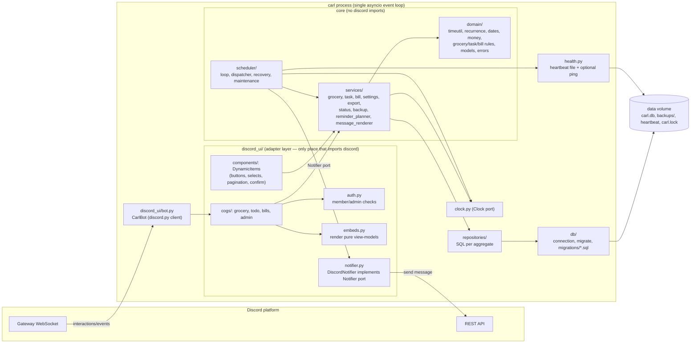
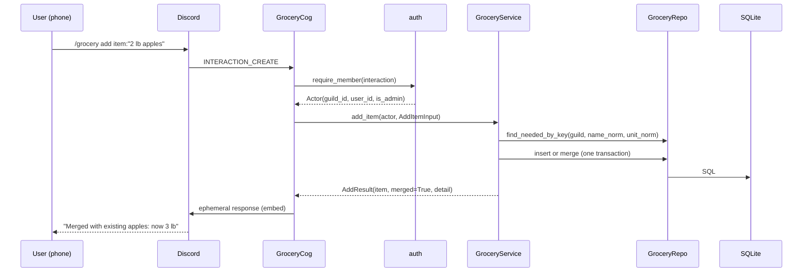
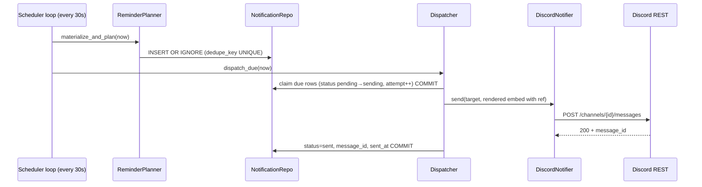

# Carl — Architecture

Status: **Approved design baseline v1.0** (2026-10-25)
Related: `architecture-decisions.md` (why), `database-design.md`, `reminder-system.md`, `implementation-plan.md` (file-level plan).

---

## 1. Summary

**One Python process, one SQLite file, no other services.**

- **Python 3.12** and **discord.py 2.7.x** keep a Gateway connection open and handle slash commands and button/select interactions.
- **SQLite** (WAL mode) holds all state, including the reminder outbox. Access goes through `aiosqlite`.
- An **in-process scheduler loop** (plain `asyncio` task, 30-second tick) reads due notifications from the database and sends them. There is no in-memory job store, so a restart loses nothing.
- **Docker Compose** runs it on any Linux host (amd64 or arm64). It can also run without Docker under `systemd` with a virtualenv.
- **Hexagonal-lite layering.** Pure domain logic and services never import `discord`. A thin Discord adapter layer translates interactions into service calls.

### Options evaluated

| Option | Shape | Verdict |
|---|---|---|
| **A. Long-running gateway bot + in-process DB-backed scheduler + SQLite** | 1 process, 1 file | **Chosen.** Simplest thing that meets every requirement. Runs on any always-on host, including a free GCP e2-micro or a Pi. |
| B. Serverless: Discord HTTP interactions endpoint + cron trigger (e.g. Cloudflare Workers + D1) | No server to manage | Rejected for v1. Free-plan CPU limit (10 ms/request, verified), JavaScript-first runtime, vendor-specific storage and cron, and a rewrite needed to move hosts. Reminders depend on the platform's cron. See ADR-004. |
| C. Bot process + separate worker + Postgres/Redis queue | Microservices | Rejected. Three moving parts for a 5-user household; needs more RAM than free hosts give; no requirement needs it. |

## 2. Component diagram



## 3. Layers and responsibilities

| Layer | Package | Responsibility | May import |
|---|---|---|---|
| Entry | `carl/__main__.py`, `carl/cli.py` | Parse CLI subcommand (`run`, `migrate`, `backup`, `restore`, `check-config`, `healthcheck`), wire dependencies | everything |
| Config | `carl/config.py` | Load and validate env vars into a frozen `Settings` dataclass; fail fast with clear messages | stdlib |
| Domain | `carl/domain/` | Pure functions and dataclasses: recurrence math, date parsing, grocery merge rules, task ordering, validation, error types | stdlib only |
| Services | `carl/services/` | Use cases. One method per user action, each in a single DB transaction. Enforce scope and authorization rules on data. Return plain dataclasses ("view models") | domain, repositories, clock, ports |
| Repositories | `carl/repositories/` | Parameterized SQL only, no business rules. Every query takes `guild_id` | db |
| DB | `carl/db/` | Open connection with pragmas; migration runner; SQL migration files; online backup | aiosqlite, sqlite3 |
| Scheduler | `carl/scheduler/` | Tick loop: materialize bill occurrences, plan notifications, dispatch due ones via `Notifier` port, apply missed/retry policy, nightly backup, retention | services, repositories, ports |
| Ports | `carl/ports.py` | `Notifier` protocol (`send_channel`, `send_dm`, `find_recent_by_ref`) and `Clock` protocol | stdlib |
| Discord adapter | `carl/discord_ui/` | Command definitions, autocomplete, components, embed rendering, authorization check, error-to-message mapping, `DiscordNotifier` | discord, services, domain |
| Health | `carl/health.py` | Write heartbeat file each tick; optional HTTP GET to `CARL_HEALTHCHECK_URL` | stdlib (`urllib`) |

**Rule (enforced by a test):** nothing under `carl/domain`, `carl/services`, `carl/repositories`, `carl/scheduler`, or `carl/db` may import `discord`. This keeps business logic portable and testable without Discord.

## 4. Data flows

### 4.1 Slash command (e.g. `/grocery add`)



Interactions must be acknowledged within 3 seconds. Every handler must respond directly (DB work is milliseconds) or `defer(ephemeral=True)` first if it may exceed ~2 s (export, backup, status).

### 4.2 Reminder



Details, failure paths, and recovery: `reminder-system.md`.

## 5. Process lifecycle

1. `python -m carl run` loads `Settings`. Missing or invalid config → exit code 2 with a message naming the variable.
2. Acquire an exclusive lock file `DATA_DIR/carl.lock` (non-blocking). If another process holds it → exit code 3: "Another Carl instance is using this data directory."
3. Open DB. If migrations are pending: online backup to `backups/pre-migration-<version>-<timestamp>.db`, then apply migrations in one transaction each.
4. Seed `guild_settings` for `CARL_GUILD_ID` from env defaults if absent.
5. Start discord.py client (`Intents.none()` + `guilds=True`). In `setup_hook`: add cogs, register persistent `DynamicItem` classes, sync guild commands if their hash changed (`app_state.command_hash`).
6. On first `on_ready`: verify guild membership, leave foreign guilds, start the scheduler task (only once; reconnects do not start a second loop).
7. Scheduler runs recovery (stuck `sending` rows) on its first tick, then normal ticks.
8. SIGTERM/SIGINT: stop scheduler after the current tick, close Discord, close DB, release lock. Docker `stop_grace_period: 30s`.

Discord disconnects are handled by discord.py's automatic reconnect. While `bot.is_ready()` is false, the dispatcher skips sending (rows stay `pending`), and planning and backups still run.

## 6. Deployment architecture

### 6.1 Primary: Google Cloud e2-micro (Always Free)

```
┌──────────── GCE e2-micro (us-central1 / us-east1 / us-west1), Debian 12 ───────────┐
│  docker engine                                                                    │
│   └─ container "carl" (python:3.12-slim, non-root uid 10001)                      │
│        restart: unless-stopped   mem_limit: 256m   read_only rootfs               │
│        volume ./data:/data  (carl.db, backups/, heartbeat, carl.lock)             │
│        outbound only: HTTPS 443 → discord.com / gateway.discord.gg                │
│  host cron: weekly off-host copy of /data/backups (optional, encrypted)           │
│  firewall: no inbound except SSH (IAP or key-only)                                │
└───────────────────────────────────────────────────────────────────────────────────┘
```

The bot listens on **no ports**. It only makes outbound connections, so it needs no load balancer, domain, TLS certificate, or inbound firewall rule.

### 6.2 Raspberry Pi with Pi-hole (supported alternative)

```
┌──────────── Raspberry Pi (64-bit Raspberry Pi OS Lite) ────────────────┐
│  pihole (native install or its own container) ── binds :53, :80/443  │
│  carl container ── binds nothing; dns: [1.1.1.1, 9.9.9.9]             │
│     mem_limit 256m, cpus 0.5, restart unless-stopped                   │
│  separate compose projects, separate data dirs, separate updates       │
└────────────────────────────────────────────────────────────────────────┘
```

Full Pi guidance: `security-and-operations.md` §10 and `hosting-comparison.md` §5.

### 6.3 Portability contract

The only host-specific inputs are `.env` and the `data/` directory. To move hosts, stop the old container, copy `data/carl.db` (or the latest backup) and `.env`, then `docker compose up -d` on the new host. The image is built for `linux/amd64` and `linux/arm64`.

## 7. Technology stack (pinned at implementation time)

| Concern | Choice | Notes |
|---|---|---|
| Language | Python 3.12 | `zoneinfo` stdlib, mature asyncio |
| Discord | `discord.py` ~= 2.7 | Latest verified 2.7.1 (2026-03-03) |
| DB driver | `aiosqlite` | Thin async wrapper over stdlib `sqlite3` |
| Time zones | stdlib `zoneinfo` + `tzdata` package | `tzdata` guarantees zone data in slim images and on Windows dev |
| Env loading (dev) | `python-dotenv` | Only loads `.env` when present |
| Packaging | `uv` with `pyproject.toml` + `uv.lock` | Plain `pip install .` also works |
| Tests | `pytest`, `pytest-asyncio`, `pytest-cov` | Fake `Clock` and fake `Notifier`, no time-mocking libraries |
| Lint/format | `ruff` (lint + format) | `mypy` optional, not gating |
| Container | Docker + Compose v2 | Multi-arch via `docker buildx` or build on host |

Runtime dependencies are exactly `discord.py`, `aiosqlite`, `tzdata`, `python-dotenv`. Adding any other runtime dependency requires approval (see `CLAUDE.md`).

### Explicitly not used
APScheduler or Celery (the DB outbox is the scheduler), SQLAlchemy/Alembic (raw SQL plus a small migration runner is easier to read at this size), Redis, Postgres, a web framework, an AI SDK.

## 8. Cross-cutting concerns

- **Time:** All instants are stored as UTC ISO-8601 text. All calendar dates (`due_date`) are local `YYYY-MM-DD` text in the household zone. Conversions happen only in `domain/timeutil.py`. See `reminder-system.md` §3.
- **Errors:** Services raise typed `CarlError` subclasses (`NotFound`, `Forbidden`, `ValidationError`, `Conflict`). The adapter maps them to user messages (`discord-commands.md` §9). Unexpected exceptions are logged with a short error ID and the user sees "Something went wrong (ref `E-7F3A`)."
- **Logging:** stdlib `logging` to stdout, `key=value` format, Docker rotates. Redaction rules: `security-and-operations.md` §5.
- **Configuration:** Secrets and infrastructure IDs come from env (`.env`). Household preferences live in the DB (`guild_settings`) and are edited via `/carl setup`.
- **Concurrency:** Single event loop and a single aiosqlite connection, so writes are serialized naturally. Each service method uses `BEGIN IMMEDIATE … COMMIT`. Two processes on one data directory are prevented by the lock file.

## 9. Key trade-offs

| Decision | Benefit | Cost / risk | Mitigation |
|---|---|---|---|
| Single process | Trivial to run, debug, move | Host down = bot down | Missed-reminder recovery; optional external dead-man ping |
| SQLite | Zero ops, one-file backup, fast | Single writer; no remote access | Ample for 5 users; online backup API |
| DB-backed scheduler instead of APScheduler | State visible in SQL, survives restart, testable | ~300 lines we own | Thorough fake-clock tests |
| Gateway bot instead of HTTP interactions | Works with discord.py, no public endpoint/TLS | Needs always-on host | Free e2-micro / Pi |
| Guild commands instead of global | Instant updates, scoped to one server | Must re-sync if guild changes | Hash-based sync on startup |
| Ephemeral-by-default replies | Privacy, less channel noise | Others don't see changes | `share:true` on grocery list |
| At-least-once delivery | Honest guarantee | Rare duplicate after crash | Ref-tag lookup before resend (`reminder-system.md` §8) |
