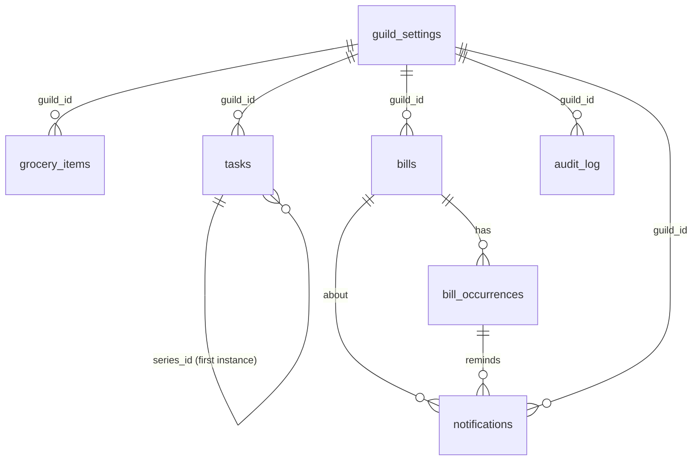

# Carl — Database Design

Status: **Approved design baseline v1.0** (2026-10-25)
Engine: SQLite ≥ 3.37 (for `STRICT` tables; python:3.12-slim ships a newer version). Accessed via `aiosqlite`.
The SQL in §4 is the normative content of `src/carl/db/migrations/0001_initial.sql`. The implementer may fix syntax errors but must not change semantics without approval.

---

## 1. Conventions

| Topic | Rule |
|---|---|
| Tables | `STRICT`, snake_case, plural names |
| Primary keys | `id INTEGER PRIMARY KEY` (rowid alias). Never reuse; never expose sequential guessing as authorization (scope checks always apply). |
| Discord IDs | `INTEGER` (snowflakes fit in signed 64-bit) |
| Instants | `TEXT` UTC ISO-8601 with `Z`, millisecond precision: `2026-10-29T14:00:00.000Z`. Produced only by `timeutil.to_db_instant()`. Lexicographic order = time order. |
| Calendar dates | `TEXT` `YYYY-MM-DD` interpreted in the household time zone (`due_date`, `paid_on_date`). |
| Local times of day | `TEXT` `HH:MM` 24-hour |
| Money | `INTEGER` minor units (`amount_minor`) + `currency TEXT` ISO 4217. Exponent table in `domain/money.py` (USD/EUR/GBP/CAD/AUD/NZD/MXN/CHF = 2, JPY/KRW = 0). Floats never touch money. |
| Booleans | `INTEGER` 0/1 with CHECK |
| Enums | `TEXT` with `CHECK (col IN (...))` |
| JSON | `TEXT` validated by the domain layer before write; `CHECK (json_valid(col))` where present |
| `created_at`, `updated_at` | On every mutable table; set by the repository (not triggers) from the injected `Clock` so tests are deterministic |
| Normalized names | `name_normalized` = NFKC → casefold → trim → collapse internal whitespace → strip a trailing `s` from the **last word** when the word is > 3 chars and doesn't end in `ss`. Used only for matching; the display `name` keeps what the user typed. |

### Connection pragmas (set on every connection open)

```sql
PRAGMA journal_mode = WAL;      -- persistent; concurrent reader during backup
PRAGMA synchronous = FULL;      -- durability on power loss (Pi) > tiny write cost
PRAGMA foreign_keys = ON;
PRAGMA busy_timeout = 5000;
PRAGMA trusted_schema = OFF;
```

## 2. Entity-relationship diagram



`guild_id` columns are scoping keys, not enforced FKs to `guild_settings`. This keeps imports simple, and the guild row always exists after startup seeding.

## 3. Table summary

| Table | Purpose | Requirements |
|---|---|---|
| `schema_migrations` | Applied migrations + checksum | FR-S-08 |
| `app_state` | Small key/value for runtime state (command hash, last backup) | FR-S-06, FR-S-09 |
| `guild_settings` | Household preferences | FR-S-04 |
| `grocery_items` | Shared grocery list | FR-G-* |
| `tasks` | Personal + household tasks, recurring series | FR-T-* |
| `bills` | Bill definitions | FR-B-01..06, 11..13 |
| `bill_occurrences` | Each due instance + payment status | FR-B-05,07..10 |
| `notifications` | Reminder/summary outbox with delivery tracking | FR-B-04,05,13,14; NFR-01,03 |
| `audit_log` | Who changed what (no sensitive values) | Security |

## 4. Schema (0001_initial.sql)

```sql
-- schema_migrations is created by the migration runner itself before applying 0001:
-- CREATE TABLE IF NOT EXISTS schema_migrations (
--   version    INTEGER PRIMARY KEY,
--   name       TEXT NOT NULL,
--   checksum   TEXT NOT NULL,        -- sha256 of the .sql file
--   applied_at TEXT NOT NULL
-- ) STRICT;

CREATE TABLE app_state (
  key        TEXT PRIMARY KEY,
  value      TEXT NOT NULL,
  updated_at TEXT NOT NULL
) STRICT;

CREATE TABLE guild_settings (
  guild_id                  INTEGER PRIMARY KEY,
  timezone                  TEXT NOT NULL,                       -- IANA, validated by zoneinfo
  reminder_channel_id       INTEGER,                             -- NULL until /carl setup
  reminder_time             TEXT NOT NULL DEFAULT '09:00'
                              CHECK (reminder_time GLOB '[0-2][0-9]:[0-5][0-9]'),
  default_currency          TEXT NOT NULL DEFAULT 'USD' CHECK (length(default_currency) = 3),
  default_bill_offsets_json TEXT NOT NULL DEFAULT '[3,0]' CHECK (json_valid(default_bill_offsets_json)),
  summary_frequency         TEXT NOT NULL DEFAULT 'off'
                              CHECK (summary_frequency IN ('off','daily','weekly')),
  summary_weekday           INTEGER NOT NULL DEFAULT 6 CHECK (summary_weekday BETWEEN 0 AND 6), -- Mon=0..Sun=6
  summary_time              TEXT NOT NULL DEFAULT '08:00'
                              CHECK (summary_time GLOB '[0-2][0-9]:[0-5][0-9]'),
  date_order                TEXT NOT NULL DEFAULT 'MDY' CHECK (date_order IN ('MDY','DMY')),
  created_at                TEXT NOT NULL,
  updated_at                TEXT NOT NULL
) STRICT;

CREATE TABLE grocery_items (
  id                    INTEGER PRIMARY KEY,
  guild_id              INTEGER NOT NULL,
  name                  TEXT NOT NULL CHECK (length(name) BETWEEN 1 AND 100),
  name_normalized       TEXT NOT NULL,
  quantity              REAL CHECK (quantity IS NULL OR (quantity > 0 AND quantity <= 9999)),
  unit                  TEXT CHECK (unit IS NULL OR length(unit) <= 20),
  unit_normalized       TEXT NOT NULL DEFAULT '',               -- '' when no unit
  category              TEXT NOT NULL DEFAULT 'other' CHECK (category IN
                          ('produce','dairy','meat_seafood','bakery','pantry','frozen',
                           'beverages','snacks','household','personal_care','other')),
  note                  TEXT CHECK (note IS NULL OR length(note) <= 300),
  status                TEXT NOT NULL DEFAULT 'needed' CHECK (status IN ('needed','purchased')),
  added_by_user_id      INTEGER NOT NULL,
  purchased_by_user_id  INTEGER,
  purchased_at          TEXT,
  created_at            TEXT NOT NULL,
  updated_at            TEXT NOT NULL,
  CHECK ((status = 'purchased') = (purchased_at IS NOT NULL))
) STRICT;

-- At most one *needed* row per (name, unit) → enables merge instead of duplicate.
CREATE UNIQUE INDEX ux_grocery_needed_key
  ON grocery_items (guild_id, name_normalized, unit_normalized) WHERE status = 'needed';
CREATE INDEX ix_grocery_list ON grocery_items (guild_id, status, category, name_normalized);

CREATE TABLE tasks (
  id                    INTEGER PRIMARY KEY,
  guild_id              INTEGER NOT NULL,
  scope                 TEXT NOT NULL CHECK (scope IN ('personal','household')),
  owner_user_id         INTEGER NOT NULL,                       -- creator
  assignee_user_id      INTEGER,
  title                 TEXT NOT NULL CHECK (length(title) BETWEEN 1 AND 200),
  notes                 TEXT CHECK (notes IS NULL OR length(notes) <= 1000),
  priority              TEXT NOT NULL DEFAULT 'normal' CHECK (priority IN ('low','normal','high')),
  due_date              TEXT,                                   -- local YYYY-MM-DD
  status                TEXT NOT NULL DEFAULT 'open' CHECK (status IN ('open','done')),
  completed_at          TEXT,
  completed_by_user_id  INTEGER,
  recurrence_json       TEXT CHECK (recurrence_json IS NULL OR json_valid(recurrence_json)),
  series_id             INTEGER REFERENCES tasks(id) ON DELETE SET NULL, -- id of first instance; NULL if not recurring
  created_at            TEXT NOT NULL,
  updated_at            TEXT NOT NULL,
  CHECK (scope = 'household' OR assignee_user_id IS NULL),
  CHECK (recurrence_json IS NULL OR due_date IS NOT NULL),
  CHECK ((status = 'done') = (completed_at IS NOT NULL))
) STRICT;

CREATE INDEX ix_tasks_visible ON tasks (guild_id, status, scope, owner_user_id, due_date);
CREATE INDEX ix_tasks_assignee ON tasks (guild_id, assignee_user_id, status);
CREATE INDEX ix_tasks_series ON tasks (series_id);

CREATE TABLE bills (
  id                      INTEGER PRIMARY KEY,
  guild_id                INTEGER NOT NULL,
  scope                   TEXT NOT NULL CHECK (scope IN ('personal','household')),
  owner_user_id           INTEGER NOT NULL,                     -- creator; recipient of personal reminders
  name                    TEXT NOT NULL CHECK (length(name) BETWEEN 1 AND 100),
  name_normalized         TEXT NOT NULL,
  amount_minor            INTEGER CHECK (amount_minor IS NULL OR amount_minor BETWEEN 0 AND 100000000000),
  currency                TEXT NOT NULL CHECK (length(currency) = 3),
  notes                   TEXT CHECK (notes IS NULL OR length(notes) <= 1000),
  first_due_date          TEXT NOT NULL,                        -- local YYYY-MM-DD; one-time bills: the due date
  recurrence_json         TEXT CHECK (recurrence_json IS NULL OR json_valid(recurrence_json)),
  reminder_offsets_json   TEXT CHECK (reminder_offsets_json IS NULL OR json_valid(reminder_offsets_json)), -- NULL = use guild default
  archived_at             TEXT,
  created_at              TEXT NOT NULL,
  updated_at              TEXT NOT NULL
) STRICT;

-- Duplicate prevention (FR-B-06): unique active name per scope (+ owner for personal).
CREATE UNIQUE INDEX ux_bills_active_name ON bills (
  guild_id, scope,
  (CASE WHEN scope = 'personal' THEN owner_user_id ELSE 0 END),
  name_normalized
) WHERE archived_at IS NULL;
CREATE INDEX ix_bills_guild ON bills (guild_id, archived_at, scope, owner_user_id);

CREATE TABLE bill_occurrences (
  id                  INTEGER PRIMARY KEY,
  bill_id             INTEGER NOT NULL REFERENCES bills(id) ON DELETE CASCADE,
  guild_id            INTEGER NOT NULL,                         -- denormalized for scoped queries
  due_date            TEXT NOT NULL,                            -- local YYYY-MM-DD
  amount_minor        INTEGER,                                  -- expected amount snapshot
  status              TEXT NOT NULL DEFAULT 'unpaid' CHECK (status IN ('unpaid','paid','skipped')),
  paid_at             TEXT,                                     -- UTC instant the user marked it
  paid_on_date        TEXT,                                     -- local date the user says they paid
  paid_by_user_id     INTEGER,
  paid_amount_minor   INTEGER CHECK (paid_amount_minor IS NULL OR paid_amount_minor >= 0),
  payment_note        TEXT CHECK (payment_note IS NULL OR length(payment_note) <= 300),
  created_at          TEXT NOT NULL,
  updated_at          TEXT NOT NULL,
  UNIQUE (bill_id, due_date),
  CHECK ((status = 'paid') = (paid_at IS NOT NULL))
) STRICT;

CREATE INDEX ix_occ_due ON bill_occurrences (guild_id, status, due_date);

CREATE TABLE notifications (
  id                  INTEGER PRIMARY KEY,
  guild_id            INTEGER NOT NULL,
  kind                TEXT NOT NULL CHECK (kind IN ('bill_reminder','bill_overdue','bill_summary')),
  dedupe_key          TEXT NOT NULL UNIQUE,
  bill_id             INTEGER REFERENCES bills(id) ON DELETE CASCADE,
  bill_occurrence_id  INTEGER REFERENCES bill_occurrences(id) ON DELETE SET NULL,
  offset_days         INTEGER,                                  -- bill_reminder only
  target_type         TEXT NOT NULL CHECK (target_type IN ('household_channel','user_dm')),
  target_user_id      INTEGER,                                  -- required for user_dm
  scheduled_for       TEXT NOT NULL,                            -- UTC instant (intended time)
  expires_at          TEXT NOT NULL,                            -- UTC instant after which it is never sent
  status              TEXT NOT NULL DEFAULT 'pending' CHECK (status IN
                        ('pending','sending','sent','failed','cancelled','skipped','expired')),
  attempt_count       INTEGER NOT NULL DEFAULT 0,
  next_attempt_at     TEXT NOT NULL,                            -- = scheduled_for initially
  last_error_code     TEXT,                                     -- e.g. 'http_503', 'dm_forbidden', 'no_channel'
  last_error_at       TEXT,
  status_reason       TEXT,                                     -- e.g. 'superseded', 'empty_summary', 'paid'
  discord_channel_id  INTEGER,
  discord_message_id  INTEGER,
  sent_at             TEXT,
  created_at          TEXT NOT NULL,
  updated_at          TEXT NOT NULL,
  CHECK (target_type = 'household_channel' OR target_user_id IS NOT NULL),
  CHECK ((status = 'sent') = (discord_message_id IS NOT NULL))
) STRICT;

CREATE INDEX ix_notif_due ON notifications (status, next_attempt_at);
CREATE INDEX ix_notif_occ ON notifications (bill_occurrence_id, status);
CREATE INDEX ix_notif_guild_status ON notifications (guild_id, status);

CREATE TABLE audit_log (
  id             INTEGER PRIMARY KEY,
  guild_id       INTEGER NOT NULL,
  actor_user_id  INTEGER,                                       -- NULL = system
  action         TEXT NOT NULL,                                 -- e.g. 'grocery.clear', 'bill.paid'
  entity_type    TEXT NOT NULL,
  entity_id      INTEGER,
  details_json   TEXT CHECK (details_json IS NULL OR json_valid(details_json)), -- field names/counts only
  at             TEXT NOT NULL
) STRICT;

CREATE INDEX ix_audit_guild_at ON audit_log (guild_id, at);
```

## 5. Recurrence representation

Stored in `bills.recurrence_json` and `tasks.recurrence_json`. Parsed and validated only by `domain/recurrence.py`.

```json
{"v": 1, "freq": "monthly", "interval": 1, "anchor": "2027-01-31", "monthday": "anchor", "until": null}
```

| Field | Values | Meaning |
|---|---|---|
| `v` | `1` | Format version |
| `freq` | `daily`, `weekly`, `monthly`, `yearly` | Base unit |
| `interval` | 1–52 | Every N units |
| `anchor` | `YYYY-MM-DD` | The first occurrence. All occurrences are computed **from the anchor**, never from the previous occurrence, so month-end clamping cannot drift. |
| `monthday` | `"anchor"` or `"last"` | Monthly only. `"anchor"` = anchor's day clamped to month length; `"last"` = last day of month |
| `until` | `YYYY-MM-DD` or null | Last allowed occurrence date (inclusive) |

Mapping from the slash-command `repeat` choice (`discord-commands.md`): `daily→{daily,1}`, `weekly→{weekly,1}`, `biweekly→{weekly,2}`, `monthly→{monthly,1,anchor}`, `monthly_last_day→{monthly,1,last}`, `quarterly→{monthly,3,anchor}`, `yearly→{yearly,1}`. `repeat_every:N` multiplies `interval`.

Algorithm for occurrence *k* (k = 0, 1, 2, …):
- daily: `anchor + k·interval days`
- weekly: `anchor + 7·k·interval days`
- monthly: target month = anchor month + k·interval. Day = `min(anchor.day, days_in_month)` for `anchor`, or `days_in_month` for `last`.
- yearly: target year = anchor year + k·interval. Same month; Feb 29 → Feb 28 in non-leap years.

Required functions (pure, exhaustively tested): `parse(json) -> Rule`, `to_json(rule)`, `occurrence(rule, k)`, `next_on_or_after(rule, date)`, `next_after(rule, date)`, `between(rule, start, end_inclusive) -> list[date]` (capped at 400 results).

## 6. Key queries (patterns the repositories must support)

- **Visible tasks for user U:** `guild_id = ? AND (scope = 'household' OR owner_user_id = U)` plus the filter. The service never fetches a task by `id` alone; every lookup includes the visibility predicate, so forged IDs return "not found".
- **Visible bills / occurrences for U:** same predicate via `bills`.
- **Due notifications:** `status = 'pending' AND next_attempt_at <= :now ORDER BY next_attempt_at LIMIT 20` (uses `ix_notif_due`).
- **Grocery merge lookup:** `guild_id = ? AND name_normalized = ? AND unit_normalized = ? AND status = 'needed'` (uses unique index).

## 7. Integrity rules enforced in services (not expressible as CHECKs)

1. `assignee_user_id` must be a current Member at assignment time (checked via the interaction's resolved member roles).
2. Occurrence `amount_minor` is updated when the bill amount changes, but only on unpaid occurrences.
3. Completing a recurring task and creating its successor happen in **one transaction** guarded by `UPDATE tasks SET status='done' … WHERE id=? AND status='open'`. The successor is created only if `rowcount = 1` (FR-T-10 idempotency).
4. Schedule edit on a bill (due date, recurrence, offsets): in one transaction, delete `unpaid` occurrences with `due_date >= today_local`, re-materialize, re-plan. Notification rows survive via the dedupe-key upsert (`reminder-system.md` §5.3), so an already-sent reminder for the same date is never re-sent.

## 8. Data retention

Daily scheduler job (`scheduler/maintenance.py`):
- `notifications` in terminal states (`sent`, `failed`, `cancelled`, `skipped`, `expired`) older than 180 days → delete.
- `audit_log` older than 365 days → delete.
- `grocery_items` purchased > 90 days ago and not cleared → left alone (user decides); shown with age in "purchased" view.
- `bill_occurrences` and `tasks`: kept indefinitely (small). Export covers them.

## 9. Migration strategy

- Files: `src/carl/db/migrations/NNNN_short_name.sql`, 4-digit, contiguous, applied in order.
- Runner (`db/migrate.py`, ~80 lines):
  1. Create `schema_migrations` if missing.
  2. For each file not yet applied: `BEGIN IMMEDIATE`, execute script, insert row with sha256 checksum, `COMMIT`. On error: `ROLLBACK`, log the version, exit code 4. The pre-migration backup stays untouched.
  3. For each applied file: recompute the checksum. A mismatch means someone edited an applied migration → refuse to start (exit code 4).
- Automatic **pre-migration backup** whenever ≥ 1 migration is pending (`backups/pre-migration-NNNN-<UTC>.db`).
- **Never edit or delete** an applied migration. Fix forward with a new file.
- For changes SQLite `ALTER TABLE` cannot do, use the documented 12-step table rebuild (create new → copy → drop → rename) inside the migration with `PRAGMA foreign_keys=OFF` handled by the runner via a `-- carl:foreign_keys_off` header directive.
- Tests: (a) migrate empty DB to latest, then compare `sqlite_schema` to a committed snapshot `tests/fixtures/schema_snapshot.sql`; (b) migration idempotency (running twice is a no-op); (c) checksum tamper detection.
- `python -m carl migrate` applies migrations without starting the bot. `python -m carl migrate --status` lists applied and pending.

## 10. Size estimate

5 users × 5 years: < 50k rows total, < 20 MB including WAL. Backups at 14 daily + 8 weekly ≈ < 500 MB worst case, far under the 30 GB GCP free disk.
