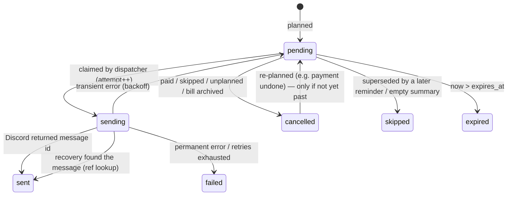

# Carl — Reminder System

Status: **Approved design baseline v1.0** (2026-10-25)
This is the most failure-sensitive part of Carl. Implement it exactly as written and test it with a fake clock and a fake notifier before connecting it to Discord.

---

## 1. Guarantees (and non-guarantees)

| We guarantee | We do **not** guarantee |
|---|---|
| Every planned reminder is stored in SQLite before its time; restarts lose nothing. | Exactly-once delivery. Discord and networks cannot support it. |
| While the process is healthy and Discord is reachable, a due reminder is sent within ~90 s. | That a person *saw* a message. "Sent" means Discord's API accepted it and returned a message ID. |
| A notification is marked `sent` only after Discord returns success. | Delivery while the host is down. Reminders missed during downtime are reconciled by policy (§7), not replayed blindly. |
| Before any re-send, the bot checks whether the earlier attempt actually landed (§8), so duplicates are rare. | Zero duplicates. If the duplicate check itself fails, Carl prefers a possible duplicate over a silent miss. |
| One overdue notice per unpaid occurrence; paid or skipped occurrences get nothing further. | DMs to users who block server DMs. Those fail permanently, are recorded, and are shown in-app. |

The delivery model is **at-least-once attempts within an expiry window, with lookup-before-resend duplicate suppression.**

## 2. Concepts

- **Bill**: a definition (name, amount, recurrence, offsets, scope).
- **Occurrence** (`bill_occurrences`): one concrete due date of a bill, with its own paid status.
- **Notification** (`notifications`): one planned message, such as "3 days before Electric due 2026-11-01". It moves through statuses:



- **Dedupe key**: a unique string that names *what* the notification is about, independent of row IDs, so re-planning never creates a second row for the same message.

| Kind | Dedupe key | Scheduled for (local → UTC) | Expires at |
|---|---|---|---|
| `bill_reminder` | `br:{bill_id}:{due_date}:{offset_days}` | `(due_date − offset) @ reminder_time` | start of `due_date + 1` (local midnight) |
| `bill_overdue` | `bo:{bill_id}:{due_date}` | `(due_date + 1) @ reminder_time` | scheduled_for + 7 days |
| `bill_summary` (household) | `bs:{guild_id}:hh:{freq}:{local_date}` | `local_date @ summary_time` | scheduled_for + 12 h |
| `bill_summary` (personal) | `bs:{guild_id}:u{user_id}:{freq}:{local_date}` | same | same |

## 3. Time handling

All conversions live in `carl/domain/timeutil.py`. Nothing else calls `datetime.now()`. Time always comes from the injected `Clock`.

| Function | Contract |
|---|---|
| `utc_now(clock) -> datetime` | aware UTC |
| `local_today(now_utc, tz) -> date` | calendar date in household zone |
| `local_to_utc(d: date, t: time, tz) -> datetime` | Builds `datetime(d, t, tzinfo=ZoneInfo(tz), fold=0)` and converts to UTC. **fold=0 always.** |
| `start_of_local_day_utc(d, tz) -> datetime` | `local_to_utc(d, 00:00)` |
| `to_db_instant(dt) / from_db_instant(s)` | `YYYY-MM-DDTHH:MM:SS.mmmZ` |

**DST rules (consequence of fold=0 with `zoneinfo`):**
- *Nonexistent local time* (spring-forward gap, e.g. 02:30 on 2027-03-14 in `America/Chicago`): resolves to the instant 02:30 would be under the pre-transition offset, i.e. **03:30 CDT** (08:30Z). The reminder fires shortly after the gap, not skipped and not doubled.
- *Ambiguous local time* (fall-back, e.g. 01:30 on 2026-11-01 in `America/Chicago`): resolves to the **first** occurrence (01:30 CDT = 06:30Z). It fires once.
- Normal times across DST (US-B1): 09:00 on 2026-10-29 = 14:00Z (CDT); 09:00 on 2026-11-01 = 15:00Z (CST).
- Due dates are calendar dates, so they never shift with DST.

Leap years and month lengths are handled by `recurrence.py` (`database-design.md` §5) using `calendar.monthrange`.

**Clock sanity:** `carl/build_info.py` holds `MIN_SANE_DATE` (set at release). If `utc_now < MIN_SANE_DATE`, which can happen on a Pi booting without NTP, the scheduler does not plan or dispatch. It logs `clock_insane` at ERROR once per minute and retries. Discord TLS would fail anyway.

## 4. Occurrence materialization

`services/reminder_planner.py :: materialize(bill, now, not_before: date | None)`

```
today   = local_today(now, tz)
if bill.archived: return
if bill.recurrence is None:
    ensure occurrence(first_due_date)            # INSERT OR IGNORE
    return
latest  = max(due_date) over this bill's occurrences (any status) or None
start   = latest + 1 day if latest else rule.anchor
if not_before: start = max(start, not_before)
horizon = max(today + 62 days, next_on_or_after(rule, today))
end     = min(horizon, rule.until) if rule.until else horizon
for d in between(rule, start, end): INSERT OR IGNORE occurrence(bill, d, amount_minor=bill.amount_minor)
```

- **Horizon 62 days** ≥ max reminder offset (60) + 2 days of slack. Reminders always exist well before they fire.
- **New bill** (`/bill add`): first insert the `first_due_date` occurrence, then call `materialize(not_before=today)`. A past first due date gives one overdue occurrence, not months of back-fill.
- **Schedule edit**: delete `unpaid` occurrences with `due_date ≥ today`, then `materialize(not_before=today)`. Edits never create new past-due occurrences.
- **Periodic run** (`not_before=None`): continues from the latest occurrence. After a long outage, real missed due dates become unpaid occurrences, and so appear as overdue. That is correct, because the bill really was due.
- `UNIQUE(bill_id, due_date)` makes materialization idempotent.

## 5. Planning notifications

`reminder_planner.plan_occurrence(occ, bill, settings, now)`. It is pure in what it computes; the repository applies the result.

### 5.1 Desired set
If `occ.status != 'unpaid'` or the bill is archived → desired = ∅.
Otherwise:
- for each `offset` in `bill.offsets or settings.default_offsets` (deduplicated): `bill_reminder`
- plus one `bill_overdue`
- target: `household_channel` if `bill.scope == 'household'`, else `user_dm(bill.owner_user_id)`

### 5.2 Insert filter (no surprise "late" messages from planning)
A desired notification is **inserted or re-activated** only if `scheduled_for ≥ now − GRACE` (GRACE = 15 min). Older desired notifications are not created. They are still part of the desired-key set, so §5.3 won't cancel an existing pending row that's waiting for the missed-reminder policy.

Effects: a bill created today due tomorrow with offset 3 gets no "3 days before" message. Undoing a payment does not resend old reminders. A bot that is down across a due date still has the rows it planned earlier (62-day horizon), so §7 applies.

### 5.3 Apply (one transaction)
```sql
-- upsert each insertable desired row
INSERT INTO notifications (... status='pending', next_attempt_at=:scheduled_for ...)
ON CONFLICT(dedupe_key) DO UPDATE SET
  bill_occurrence_id = excluded.bill_occurrence_id,
  target_type = excluded.target_type, target_user_id = excluded.target_user_id,
  scheduled_for = excluded.scheduled_for, next_attempt_at = excluded.scheduled_for,
  expires_at = excluded.expires_at, status = 'pending', status_reason = NULL,
  updated_at = excluded.updated_at
WHERE notifications.status = 'cancelled'
   OR (notifications.status = 'pending' AND notifications.attempt_count = 0);
-- rows already sent/failed/expired/skipped, or pending-in-retry, are never touched.

-- cancel pending rows for this occurrence that are no longer desired
UPDATE notifications SET status='cancelled', status_reason='unplanned', updated_at=:now
WHERE bill_occurrence_id = :occ AND status = 'pending' AND dedupe_key NOT IN (:desired_keys);
```

### 5.4 When planning runs
| Trigger | Scope |
|---|---|
| `/bill add`, `/bill edit`, `/bill unpaid` | that bill (inside the same transaction as the user's change, so the reply can show the next reminder times) |
| `/bill paid`, `/bill skip`, Mark paid / Skip buttons | cancel all pending for that occurrence (`status_reason='paid'|'skipped'`) |
| `/bill delete` (archive) | cancel all pending for that bill (`'archived'`) |
| `/carl setup` (timezone, reminder time, default offsets, channel) | all active bills + summaries |
| `/carl summary` | summaries: cancel pending `bill_summary`, re-plan |
| Scheduler safety net | every 10 min and at each local-date change: materialize + plan all active bills, plan summaries |

## 6. Scheduler loop

`scheduler/loop.py` runs one asyncio task, started once after the first `on_ready`.

```
every TICK = 30 s (sleep until next tick; ticks never overlap):
  1. health.beat()                              # heartbeat file; optional ping every 5 min
  2. if not clock_sane(): continue
  3. recover_stuck_sending()                    # §8; at the very first tick: all 'sending' rows
  4. if safety-net due: materialize_and_plan_all(); plan_summaries()
  5. if bot.is_ready(): dispatch_due(limit=20)  # loop until no due rows or 20 sent this tick
  6. maintenance_if_due()                       # daily backup at CARL_BACKUP_TIME local (default 03:30), retention
each step in its own try/except: log with error id, continue to the next step.
```

Throughput: 20 messages/tick is far above household volume. discord.py handles per-route rate limits.

## 7. Dispatch and the missed-reminder policy

`scheduler/dispatcher.py :: dispatch_due(now)`

For each `pending` row with `next_attempt_at ≤ now`, ordered by `next_attempt_at`:

1. **Validity:** load occurrence, bill, and settings. If the occurrence is gone, paid, or skipped, or the bill is archived → `cancelled` (reason). Summary rows: if summaries are now off → `cancelled`.
2. **Expiry:** `now > expires_at` → `expired`.
3. **Lateness** (bill kinds only, and only on the first attempt, `attempt_count = 0`): if `now − scheduled_for > GRACE (15 min)`, the row is *late*:
   - Select all `pending` bill rows for the same occurrence with `scheduled_for ≤ now` and not expired.
   - Keep **only the one with the latest `scheduled_for`** (the overdue notice beats due-day, which beats 3-days-before). Mark the others `skipped` (`superseded`).
   - Send the kept row with the "Delayed reminder (bot was offline)" line.
4. **Summary content:** render at send time. A daily summary with nothing to report → `skipped` (`empty_summary`). Weekly summaries are always sent ("Nothing due this week").
5. **Claim:** `UPDATE … SET status='sending', attempt_count=attempt_count+1, updated_at=:now WHERE id=:id AND status='pending'`, then COMMIT. Continue only if rowcount = 1.
6. **Lookup-before-resend:** if `attempt_count > 1` after the claim, **or** the row has `status_reason = 'restored'` (set by `carl restore`, `security-and-operations.md` §8), call `notifier.find_recent_by_ref(target, ref)` first. If found → `sent` (reason `recovered`) without sending.
7. **Send:** render from *current* data (amount and name edits show up) and call `notifier.send(...)`.
8. **Record:** success → `sent`, `discord_channel_id`, `discord_message_id`, `sent_at`. Failures → §9.

Resulting behavior for the US-B4 scenarios (offsets 3,0; overdue next day):

| Bot offline… | Result on restart |
|---|---|
| over the 3-day reminder only | one delayed "due in 3 days" reminder |
| over both 3-day and due-day, back on due date | one delayed "due today" (3-day superseded) |
| back after the due date | 3-day and due-day expired; one "overdue" notice (if within 7 days) |
| back > 7 days after due date | everything expired; occurrence shows in `/bill overdue` and summaries |
| bill paid while offline (via another path) | n/a: the only path is the bot, so all rows are cancelled at pay time |

## 8. Delivery tracking and crash recovery

Each message carries a **ref tag** in its embed footer: `ref N-{notification_id}`. The bot can always read its own messages without the message-content intent, so the ref can be found in channel or DM history.

`Notifier` port (`carl/ports.py`):

```python
class Notifier(Protocol):
    async def send(self, target: Target, message: RenderedMessage) -> SendResult: ...
    async def find_recent_by_ref(self, target: Target, ref: str, limit: int = 50) -> FoundMessage | None: ...
    async def edit_components_removed(self, channel_id: int, message_id: int, footer: str) -> None: ...
```

**Stuck `sending` rows**: the process died, or hung, between claim and record.
- At the first tick after startup: all `sending` rows. At later ticks: `sending` rows with `updated_at < now − 120 s`.
- For each: `find_recent_by_ref`. Found → `sent` (`recovered`). Not found → `pending`, `next_attempt_at = now`. Lookup error → `pending` (accept a possible duplicate rather than a silent miss).

**Remaining duplicate window:** Discord accepts the message, the process dies, and the later history lookup fails, all at once. This is rare and acceptable for a household bot.

## 9. Retries and error classification

`DiscordNotifier` maps exceptions to a `SendResult`:

| Condition | Class | `last_error_code` |
|---|---|---|
| Success | `ok` | — |
| `aiohttp.ClientError`, `asyncio.TimeoutError`, `discord.DiscordServerError` (5xx), HTTP 429 after library retries, client not ready | transient | `network`, `timeout`, `http_5xx`, `rate_limited`, `not_ready` |
| Reminder channel not configured; `Forbidden` 50013 (missing permissions); `NotFound` 10003 (unknown channel) | transient (an admin can fix it); WARNING log + visible in `/carl status` | `no_channel`, `missing_permissions`, `unknown_channel` |
| `Forbidden` 50007 (cannot DM user) | permanent | `dm_forbidden` |
| `NotFound` 10013 (unknown user) | permanent | `unknown_user` |
| Any other `discord.HTTPException` 4xx | permanent | `http_4xx_{code}` |
| Unexpected exception | transient (logged with error id) | `internal` |

**Backoff** for transient failures, by attempt number: 1 m, 2 m, 5 m, 10 m, 30 m, 1 h, 2 h, 4 h. After attempt 8 fails → `failed` (`retries_exhausted`). If `next_attempt_at > expires_at` → `expired`. Late-policy labeling (§7.3) applies only to the first attempt. Retries reuse the original rendering rules.

Personal reminders are **never** redirected to the shared channel on DM failure, for privacy (US-B7). `/bill upcoming` and `/bill list` show "⚠ last reminder could not be delivered" for occurrences with a `failed` notification.

## 10. Summaries

`reminder_planner.plan_summaries(guild, now)`. Runs on the safety-net cadence and after `/carl summary`.
- `daily`: plan for `today` (if `today @ summary_time ≥ now − GRACE`) and `tomorrow`.
- `weekly`: plan for the next date (today included, same GRACE rule) whose weekday = `summary_weekday`.
- Targets: one household row (`household_channel`) plus one personal row per Member who owns ≥ 1 active personal bill.
- Content (rendered at send): daily = overdue + due today + next 3 days. Weekly = overdue + next 7 days. Grouped by date, totals per currency. Household rows show household bills only; personal rows show the user's personal bills only.

## 11. Outage behavior

| Event | Behavior |
|---|---|
| Discord Gateway disconnects | discord.py reconnects automatically. Dispatcher skips while `not is_ready()`. Rows stay `pending`; §7 applies when back. Slash commands are unavailable meanwhile (Discord shows "application did not respond"). |
| Discord REST errors / outage | Transient backoff; expiry bounds retries. |
| Host internet down | Same as Discord outage. Planning and backups continue locally. |
| Host power loss / reboot | `synchronous=FULL` + WAL means committed data survives. Docker `restart: unless-stopped` + `systemctl enable docker` restart the bot. First tick runs stuck-row recovery. |
| Process crash loop | Docker restarts with backoff. Heartbeat goes stale, so the external dead-man ping (if configured) alerts the operator. |
| Clock wrong at boot (Pi without RTC/NTP) | Clock-sanity guard (§3). Operator doc enables `systemd-time-wait-sync`. |
| Two instances with the same token | Prevented on the same data dir by the lock file. Across hosts, prevented by procedure: dev uses a separate Discord application and token (`security-and-operations.md` §3). |

## 12. Settings changes

- **Time zone change**: re-plan everything. Dedupe keys use local dates, so rows are updated in place (new `scheduled_for`, `expires_at`). Sent rows are untouched.
- **Reminder time change**: same. A reminder whose new time already passed today is not re-inserted (insert filter); if it was already sent, nothing happens.
- **Channel change**: target is resolved at send time, so pending household rows go to the new channel automatically.
- **Default offsets change**: re-plan all bills that use the default.

## 13. Required tests (all with `FakeClock` + `FakeNotifier`, in-memory/temp SQLite)

| # | Scenario | Expectation |
|---|---|---|
| R1 | US-B1 times across DST (America/Chicago) | exact UTC instants 14:00Z / 15:00Z |
| R2 | Reminder time 02:30 on spring-forward day | fires 08:30Z once |
| R3 | Reminder time 01:30 on fall-back day | fires 06:30Z once |
| R4 | Monthly anchor 31st through Feb (leap and non-leap), Apr, back to 31 | US-B2 dates |
| R5 | Yearly Feb 29 | Feb 28 in non-leap, Feb 29 in leap |
| R6 | Planner run twice | identical rows, no duplicates |
| R7 | Mark paid | pending rows cancelled; nothing sent after |
| R8 | Undo payment after reminder times passed | no old reminders resent; future ones re-activated |
| R9 | Each row of the §7 outage table | exact sent/skipped/expired sets |
| R10 | Transient errors ×3 then success | 4 attempts, backoff spacing, one `sent` |
| R11 | Crash after send before record (FakeNotifier records message, row left `sending`) | recovery finds ref → `sent`, FakeNotifier sent count = 1 |
| R12 | Crash with lookup failure | resent once; documented duplicate |
| R13 | `dm_forbidden` | `failed`, never posted to channel, warning surfaced in upcoming view model |
| R14 | Time zone change with pending rows | scheduled_for recomputed; sent rows untouched |
| R15 | Schedule edit same next due date after 3-day reminder already sent | not resent |
| R16 | Daily summary empty | `skipped` |
| R17 | Clock before MIN_SANE_DATE | nothing planned or sent |
| R18 | Not ready (gateway down) for 2 h across a reminder | sent once on ready, labeled delayed |
